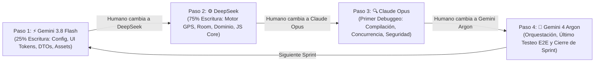

# 🤖 Gobernanza y Guía Operativa para Agentes (`AGENTS.md`)

Este archivo define las reglas obligatorias, estándares de código, distribución de responsabilidades y protocolo de entrega secuencial (**Human-in-the-Loop**) para los agentes de IA que construyen y mantiene **CronoBus**.

---

## 1. Flujo de Trabajo Secuencial (Human-in-the-Loop)

Dado que el desarrollador humano cambia manualmente de modelo paso a paso en la interfaz, **el trabajo es estrictamente secuencial** (un agente a la vez por turno). Ningún agente debe asumir que otro agente está corriendo en paralelo.

### Roles y Cuotas Estrictas
1. **Gemini 4 Argon (Orquestador y Último Testeo):**
   - Abre y cierra cada Sprint actualizando [`to_do.md`](file:///c:/Users/fernando.dorantes/local/scripts/proyectos/app_rutas/to_do.md).
   - Entrega al humano el prompt exacto para copiar/ejecutar en el siguiente turno y audita que se respete la proporción **75% DeepSeek / 25% Gemini 3.8 Flash**.
   - Ejecuta la batería de validación final al cierre de cada Sprint (`./gradlew testDebugUnitTest`, `./gradlew assembleDebug`, pruebas Roborazzi y verificación de las 3 vistas).
2. **Gemini 3.8 Flash (Escritor Secundario — 25% del trabajo de escritura):**
   - Entra primero en cada Sprint para preparar el terreno rápido: manifiestos, `build.gradle.kts`, recursos XML, temas Compose (`Color.kt`, `Theme.kt`, `Type.kt`), CSS offline local en `assets/`, DTOs/Entities base y modales HTML de apoyo.
3. **DeepSeek (Escritor Principal — 75% del trabajo de escritura):**
   - Entra después de Flash y construye el núcleo pesado sobre los DTOs/recursos creados: capa de dominio (`KalmanLocationFilter`, `GeofenceEngine`, `TamperDetector`, `EvaluateForceMajeureUseCase`), capa de datos (`CronoBusDatabase`, DAOs, `StoreAndForwardSyncManager`), `LocationTrackingService` en segundo plano, `CronoBusJsBridge` y refactorización reactiva de [`cronobus.html`](file:///c:/Users/fernando.dorantes/local/scripts/proyectos/app_rutas/app/src/main/assets/cronobus.html).
4. **Claude Opus (Primer Debuggeo y Auditoría):**
   - Entra inmediatamente después de DeepSeek en cada Sprint.
   - Revisa todo el código escrito en los pasos de Flash y DeepSeek, ejecuta compilación de diagnóstico, corrige errores de Kotlin/KSP, condiciones de carrera en `Coroutines`/`Flow`, fugas de memoria del `WebView`/`ForegroundService`, permisos de Android 14-16 y vulnerabilidades de seguridad (OWASP MASVS).

---

## 2. Reglas de Oro del Código (Inquebrantables)

1. **Cero Dependencia de Red para el Arranque (Offline-First Real):**
   - Ninguna pantalla puede depender de un CDN externo para verse bien. Si `cdn.tailwindcss.com` no responde, el CSS local en `assets/` debe mantener el 100% del diseño **Classic Signal**.
2. **Fidelidad Estricta al Design System (`Classic Signal`):**
   - Colores obligatorios: Primary `#0a0a0a`, Secondary `#0b6c4b`, Secondary Container `#a0f4ca`, Accent `#ffba38`, Error `#ba1a1a`, Surface `#f9f9f9`, Border `#c4c7c7` (1px sólido).
   - Prohibido usar sombras difusas (`blur > 0`); usar únicamente sombras duras (`4px 4px 0px rgba(10,10,10,0.1)`) o bordes sólidos de `1px`.
3. **Resiliencia en Segundo Plano y Reloj Monotónico:**
   - El rastreo del conductor debe sobrevivir al bloqueo de pantalla mediante `LocationTrackingService` con `foregroundServiceType="location"`.
   - Para evitar fraude por cambio de hora del teléfono, validar intervalos con `SystemClock.elapsedRealtimeNanos()` y el tiempo GPS satelital.
4. **Cumplimiento Legal (LGPDPPSO y LFT):**
   - Nunca almacenar datos biométricos ni identificadores personales de pasajeros (el conteo de ocupación es estrictamente agregado: `BAJA`, `MEDIA`, `LLENO`).
   - Todo turno de conductor requiere registro de aceptación del aviso de privacidad y geolocalización laboral.
5. **Compatibilidad con Gradle y KSP del Proyecto:**
   - Mantener `org.gradle.configuration-cache=false` y `kotlin.compiler.execution.strategy=in-process` en [`gradle.properties`](file:///c:/Users/fernando.dorantes/local/scripts/proyectos/app_rutas/gradle.properties) para evitar bloqueos del daemon en Windows.

---

## 3. Protocolo de Handoff entre Turnos (Human-in-the-Loop)

Al finalizar su turno, cada agente debe imprimir al final de su respuesta un bloque resumen claro para que el humano simplemente cambie de modelo en el selector y escriba *"Continúa con el Paso X"*:

1. **Paso Completado:** Número de paso y modelo que lo ejecutó.
2. **Archivos Creados / Modificados:** Lista con rutas exactas.
3. **Contratos / Estado para el Siguiente Agente:** Qué quedó listo y qué debe revisar o conectar el siguiente modelo en la fila.
4. **Instrucción para el Humano:** Qué modelo seleccionar a continuación y qué prompt pegarle.
