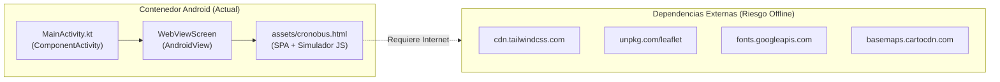
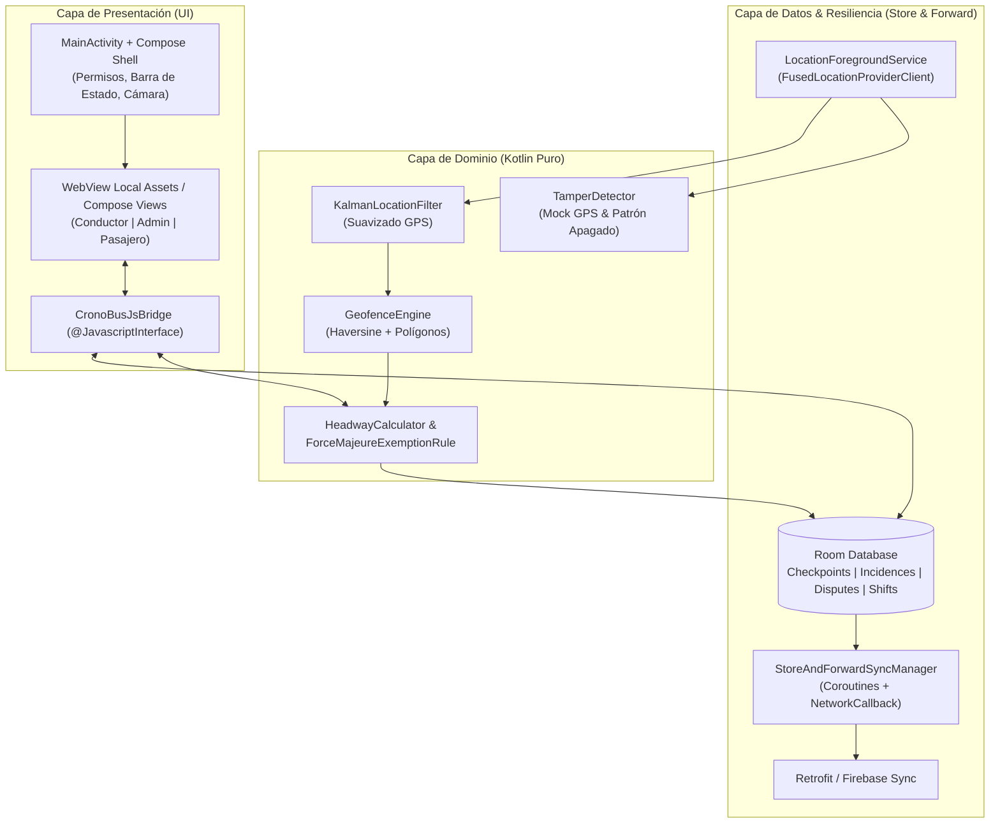

# 🏗️ Arquitectura Técnica — CronoBus Android

Este documento describe la arquitectura actual del repositorio, sus brechas técnicas identificadas en la evaluación inicial y la arquitectura objetivo para llevar **CronoBus** a un MVP de producción resiliente.

---

## 1. Diagnóstico del Estado Actual (As-Is)



### Fortalezas Actuales
1. **Stack de Gradle Moderno:** Configurado con AGP `9.1.1`, Kotlin `2.2.10`, `compileSdk 36`, `minSdk 24` y catálogo centralizado en [`gradle/libs.versions.toml`](file:///c:/Users/fernando.dorantes/local/scripts/proyectos/app_rutas/gradle/libs.versions.toml) que ya incluye `Room`, `Retrofit`, `Moshi`, `Coroutines`, `Play Services Location`, `CameraX`, `Firebase` y `Roborazzi`.
2. **Prototipo Funcional Completo en UI:** [`cronobus.html`](file:///c:/Users/fernando.dorantes/local/scripts/proyectos/app_rutas/app/src/main/assets/cronobus.html) implementa fielmente el sistema de diseño **Classic Signal** y permite visualizar los tres flujos (Conductor, Despacho, Pasajero).
3. **Configuración de Build Estable:** [`gradle.properties`](file:///c:/Users/fernando.dorantes/local/scripts/proyectos/app_rutas/gradle.properties) ya tiene mitigaciones para memoria (`-Xmx4g`) y desactivación de caché de configuración inestable.

### Debilidades y Deuda Técnica Crítica
1. **Falso Modo Offline:** Aunque el prototipo tiene un botón `Offline Mode`, carga TailwindCSS, Leaflet y Google Fonts desde CDNs externos. Si la app se abre en una base de combis sin señal celular, el `WebView` pierde estilos y mapas. Además, el botón solo cambia un booleano en memoria (`state.signalLost`), sin persistir en `IndexedDB` ni en `Room`.
2. **Ausencia de GPS Nativo y Ejecución en Segundo Plano:** No hay permisos de ubicación en [`AndroidManifest.xml`](file:///c:/Users/fernando.dorantes/local/scripts/proyectos/app_rutas/app/src/main/AndroidManifest.xml) ni un `ForegroundService`. En un teléfono real, en cuanto el chofer bloquea la pantalla, el `requestAnimationFrame` del `WebView` se congela.
3. **Dependencias Desactivadas y Código Plantilla:** En [`app/build.gradle.kts`](file:///c:/Users/fernando.dorantes/local/scripts/proyectos/app_rutas/app/build.gradle.kts) las librerías de ubicación, permisos, cámara, navegación y DataStore están comentadas. El paquete sigue llamándose `com.example` y el tema Compose (`Color.kt`) tiene los colores morados de plantilla de Android Studio.
4. **Lógica de Negocio Simulada con `alert()`:** Acciones clave como reportar incidencias, apelar multas o exportar CSV disparan `window.alert(...)` sin persistencia ni validación de reglas (como la exención automática por 3 reportes en 500m / 15 min).

---

## 2. Arquitectura Objetivo (To-Be: Híbrida Reforzada / Nativa Modular)

Para maximizar la velocidad de entrega de los agentes manteniendo la riqueza visual ya lograda, se establece una arquitectura **Clean Architecture + MVVM en Kotlin** conectada mediante un puente nativo bidireccional (`CronoBusNativeBridge`) y/o pantallas Compose nativas:



---

## 3. Especificación de Componentes Clave

### 3.1 Estructura de Paquetes (`com.cronobus.app`)
```
app/src/main/java/com/cronobus/app/
├── MainActivity.kt
├── CronoBusApplication.kt
├── bridge/
│   └── CronoBusJsBridge.kt          # Comunicación segura Kotlin <-> WebView JS
├── data/
│   ├── local/
│   │   ├── CronoBusDatabase.kt      # Instancia Room
│   │   ├── dao/                     # CheckpointDao, IncidenceDao, DisputeDao, ShiftDao
│   │   └── entity/                  # Entidades Room con flags de sincronización
│   ├── remote/
│   │   └── CronoBusApiService.kt    # Endpoints REST / Sincronización por lotes
│   └── repository/
│       └── TransitRepository.kt     # Fuente única de verdad (Offline-First)
├── domain/
│   ├── location/
│   │   ├── KalmanLocationFilter.kt  # Filtro de ruido GPS urbano
│   │   ├── GeofenceEngine.kt        # Evaluación de geocercas con histéresis
│   │   └── TamperDetector.kt        # Detección de Mock GPS y apagados sospechosos
│   ├── model/                       # Modelos de dominio inmutables
│   └── usecase/
│       ├── EvaluateForceMajeureUseCase.kt # Regla: >=3 reportes en <500m y <15min
│       ├── CalculateHeadwayUseCase.kt     # Cálculo de intervalo delantero/trasero
│       └── ExportFinancialCsvUseCase.kt   # Exportación real de métricas SaaS + Multas
├── service/
│   ├── LocationTrackingService.kt   # ForegroundService para rastreo continuo en ruta
│   └── SyncManager.kt               # Motor Store & Forward reactivo a red
└── ui/
    ├── theme/                       # Tokens Classic Signal (#0a0a0a, #0b6c4b, #ffba38)
    └── components/                  # Diálogos nativos (Consentimiento LFT, Cámara Apelación)
```

### 3.2 Esquema de Base de Datos Local (`Room`) para *Store & Forward*
Todas las tablas operativas incluyen metadatos de sincronización para garantizar cero pérdida de datos en zonas sin cobertura:
- `id`: `UUID` generado localmente.
- `recordedAtEpochMs`: Timestamp monotónico validado contra reloj GPS.
- `syncStatus`: `PENDING` | `SYNCING` | `SYNCED` | `FAILED`.
- `retryCount`: Contador de intentos para *Exponential Backoff*.
- `isMockDetected`: Flag de auditoría anti-sabotaje.

### 3.3 Algoritmo de Exención Automática por Fuerza Mayor
1. Cada vez que una unidad registra un `IncidenceReport` de tipo `TRAFFIC` o `BLOCKADE`, se almacena con sus coordenadas $(lat_i, lng_i)$ y timestamp $t_i$.
2. `EvaluateForceMajeureUseCase` busca reportes activos en la misma ruta tales que:
   $$\text{distancia\_haversine}(P_{\text{nuevo}}, P_i) \le 500\text{ m} \quad \text{y} \quad |t_{\text{nuevo}} - t_i| \le 15\text{ min}$$
3. Si el conteo de unidades distintas es $\ge 3$, el tramo se marca en estado `FORCE_MAJEURE_ACTIVE` y todas las multas generadas en ese segmento/ventana pasan automáticamente a estado `EXEMPTED_FORCE_MAJEURE`.
