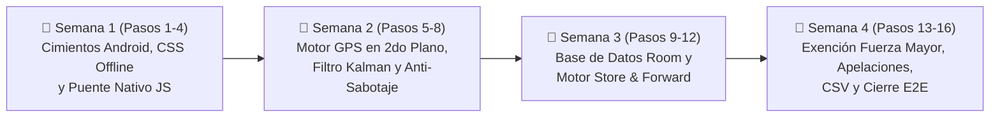

# 🗓️ Plan Maestro de Ejecución por Agentes (`PLAN_AGENTES.md`)
**Cronograma de 4 Semanas (1 Bloque por Semana) — Flujo Secuencial Human-in-the-Loop**

Este documento es tu guía operativa paso a paso para construir el MVP productivo de **CronoBus** en **4 semanas**. Dado que el flujo es **Human-in-the-Loop (HITL)** sin orquestadores externos, tú diriges el avance cambiando manualmente el modelo en el selector del IDE al terminar cada paso y pegando el **Prompt Listo para Copiar** incluido en cada sección.

---

## 📊 Resumen de Roles, Cuotas y Calendario

| Rol | Modelo | Cuota | Turno en cada Semana |
|---|---|---|---|
| **Escritor Secundario** | **Gemini 3.8 Flash** | **25% Escritura** | **Paso 1 de la semana** (Configuración, Manifiesto, Temas UI, CSS Offline, DTOs/Entities base) |
| **Escritor Principal** | **DeepSeek** | **75% Escritura** | **Paso 2 de la semana** (Motor GPS, Filtro Kalman, Geocercas, Room DAOs, Sync Offline, Casos de Uso, JS Core) |
| **Primer Debugger** | **Claude Opus** | **100% Auditoría & Fixes** | **Paso 3 de la semana** (Revisión estática, concurrencia, KSP, permisos Android 14-16, seguridad OWASP) |
| **Orquestador & QA Final** | **Gemini 4 Argon** | **Orquestación + Testeo E2E** | **Paso 4 de la semana** (Ejecución de tests unitarios, Robolectric/Roborazzi, `assembleDebug` y cierre en `to_do.md`) |



---

# 📅 SEMANA 1: Cimientos Android, Modo 100% Offline Visual y Puente JS
*Objetivo de la Semana 1: Que la app tenga todos sus permisos declarados, tema visual Classic Signal, estilos CSS 100% offline (sin depender del CDN de Tailwind) y un puente bidireccional seguro entre Kotlin y el WebView.*

---

### 🔹 Paso 1 (Semana 1, Día 1) — Turno de: `Gemini 3.8 Flash` (25% Escritura)
- **Acción del Developer:** Selecciona **Gemini 3.8 Flash** en el selector de modelos y pega el siguiente prompt:

```markdown
Actúa como el Escritor Secundario (25%) del proyecto CronoBus siguiendo estrictamente las reglas de `AGENTS.md` y `ARCHITECTURE.md`.
Ejecuta el **Paso 1 de la Semana 1**:

1. En `app/build.gradle.kts`, descomenta las dependencias de ubicación, permisos, datastore y cámara (`libs.play.services.location`, `libs.accompanist.permissions`, `libs.androidx.datastore.preferences`, `libs.androidx.camera.core`, `libs.androidx.camera.camera2`, `libs.androidx.camera.lifecycle`, `libs.androidx.camera.view`).
2. En `app/src/main/AndroidManifest.xml`, declara los permisos:
   - `ACCESS_FINE_LOCATION` y `ACCESS_COARSE_LOCATION`
   - `ACCESS_BACKGROUND_LOCATION`
   - `FOREGROUND_SERVICE` y `FOREGROUND_SERVICE_LOCATION`
   - `ACCESS_NETWORK_STATE`
   - `CAMERA`
   - `POST_NOTIFICATIONS`
3. Actualiza `app/src/main/java/com/example/ui/theme/Color.kt` y `Theme.kt` reemplazando los colores morados de plantilla por los tokens exactos del sistema de diseño **Classic Signal** (`Designs/Design_green.md`) y **CronoBus Dark Mode** (`Designs/Design_dark.md`).
4. Crea el archivo `app/src/main/assets/classic_signal_offline.css` con todas las reglas CSS utilitarias, colores, grillas, bordes de 1px (`#c4c7c7`) y sombras duras (`4px 4px 0px rgba(10,10,10,0.1)`) que utiliza `app/src/main/assets/cronobus.html`, para que la interfaz se vea 100% idéntica cuando el dispositivo inicie sin conexión a internet y falle `cdn.tailwindcss.com`.

Al terminar, imprime el bloque de Handoff de `AGENTS.md` para DeepSeek.
```

---

### 🔹 Paso 2 (Semana 1, Día 2) — Turno de: `DeepSeek` (75% Escritura)
- **Acción del Developer:** Cambia el modelo a **DeepSeek** y pega el siguiente prompt:

```markdown
Actúa como el Escritor Principal (75%) del proyecto CronoBus siguiendo `AGENTS.md` y `ARCHITECTURE.md`.
Revisa los archivos creados por Gemini 3.8 Flash en el Paso 1 y ejecuta el **Paso 2 de la Semana 1**:

1. Crea `app/src/main/java/com/example/bridge/CronoBusJsBridge.kt`:
   - Implementa una clase con métodos `@JavascriptInterface` seguros y bien estructurados que reciban/entreguen JSON (usando Moshi): `reportIncidence(json)`, `updateOccupancy(level)`, `submitFineDispute(json)`, `acceptShiftConsent(json)`, `getSystemStatusJson()` y `exportFinancialCsv(json)`.
   - Incluye un callback seguro hacia el hilo principal (`Dispatchers.Main`) para enviar eventos desde Kotlin hacia JavaScript mediante `webView.evaluateJavascript("window.onNativeCronoBusEvent(...)", null)`.
2. Refactoriza `app/src/main/java/com/example/MainActivity.kt`:
   - Solicita en tiempo de ejecución los permisos de ubicación (`ACCESS_FINE_LOCATION`, `ACCESS_COARSE_LOCATION`) y notificaciones (`POST_NOTIFICATIONS`).
   - Endurece la seguridad del `WebView` (desactiva `allowFileAccess = true` global, restringe `mixedContentMode` y registra `addJavascriptInterface(bridge, "CronoBusNative")`).
   - Asegura que el `WebView` conserve su estado ante recomposiciones.
3. En `app/src/main/assets/cronobus.html`:
   - Enlaza `<link rel="stylesheet" href="classic_signal_offline.css">` en el `<head>`.
   - Agrega un módulo adaptador JavaScript `NativeBridgeAdapter` que detecte `window.CronoBusNative` y conecte los botones actuales de la interfaz con el puente nativo (manteniendo compatibilidad de respaldo si se abre en un navegador de PC).

Al terminar, imprime el bloque de Handoff de `AGENTS.md` para Claude Opus.
```

---

### 🔹 Paso 3 (Semana 1, Día 3) — Turno de: `Claude Opus` (Primer Debuggeo)
- **Acción del Developer:** Cambia el modelo a **Claude Opus** y pega el siguiente prompt:

```markdown
Actúa como el Primer Debugger y Auditor Técnico del proyecto CronoBus siguiendo `AGENTS.md`.
Ejecuta el **Paso 3 de la Semana 1**:

1. Revisa exhaustivamente todos los cambios realizados en los Pasos 1 y 2 (`app/build.gradle.kts`, `AndroidManifest.xml`, `Color.kt`, `Theme.kt`, `CronoBusJsBridge.kt`, `MainActivity.kt`, `classic_signal_offline.css` y `cronobus.html`).
2. Verifica que no existan llamadas a métodos de `WebView` fuera del Main Thread (`Dispatchers.Main`) desde `@JavascriptInterface`, que no haya fugas de memoria de `Context`/`WebView` en `CronoBusJsBridge`, y que las anotaciones de Moshi/Kotlin compilen sin errores.
3. Ejecuta una compilación de diagnóstico (`./gradlew compileDebugKotlin`) y corrige directamente cualquier bug, warning de seguridad o discrepancia visual con Classic Signal.

Al terminar, imprime el reporte de auditoría y el Handoff para Gemini 4 Argon.
```

---

### 🔹 Paso 4 (Semana 1, Día 4-5) — Turno de: `Gemini 4 Argon` (Último Testeo y Cierre de Semana 1)
- **Acción del Developer:** Cambia el modelo a **Gemini 4 Argon** y pega el siguiente prompt:

```markdown
Actúa como el Orquestador y Responsable del Último Testeo de CronoBus siguiendo `AGENTS.md`.
Ejecuta el **Paso 4 (Cierre de la Semana 1)**:

1. Ejecuta `./gradlew testDebugUnitTest` y `./gradlew assembleDebug` para validar que el APK compile limpiamente y que las pruebas unitarias y de captura de pantalla (`GreetingScreenshotTest.kt`) pasen sin errores.
2. Verifica que todos los entregables de la Fase 1 estén completos y marca con `[x]` las tareas correspondientes de la Fase 1 en `to_do.md`.
3. Entrégame el resumen ejecutivo de cierre de la Semana 1.
```

---

# 📅 SEMANA 2: Motor GPS en Segundo Plano, Filtro de Kalman, Geocercas y Anti-Sabotaje
*Objetivo de la Semana 2: Implementar la lectura real de GPS con pantalla apagada (`ForegroundService`), suavizar el ruido urbano con un filtro de Kalman 2D, detectar cruces de estaciones automáticamente y detectar intentos de fraude (Mock GPS o apagados deliberados).*

---

### 🔹 Paso 5 (Semana 2, Día 1) — Turno de: `Gemini 3.8 Flash` (25% Escritura)
- **Acción del Developer:** Selecciona **Gemini 3.8 Flash** y pega el siguiente prompt:

```markdown
Actúa como el Escritor Secundario (25%) de CronoBus siguiendo `AGENTS.md` y `ARCHITECTURE.md`.
Ejecuta el **Paso 5 de la Semana 2**:

1. Crea los modelos de dominio inmutables en `app/src/main/java/com/example/domain/model/`:
   - `BusLocation.kt` (lat, lng, speedMps, accuracyMeters, bearing, elapsedRealtimeNanos, satelliteTimeMs, isMock).
   - `GeofenceStation.kt` (id, name, centerLat, centerLng, radiusMeters, polygonPoints, scheduledOffsetMinutes).
   - `CheckpointCrossingEvent.kt` (stationId, stationName, unitId, enteredAtEpochMs, exitedAtEpochMs, deltaSecondsVsSchedule, status).
   - `TamperAlert.kt` (type: `MOCK_LOCATION` | `CLOCK_MANIPULATION` | `NEAR_STATION_SHUTDOWN`, description, distanceToNearestStationMeters, batteryLevelPct, timestampMs).
2. Crea `app/src/main/java/com/example/service/NotificationHelper.kt` para gestionar el canal de notificación de Android (`IMPORTANCE_LOW`) y construir la notificación persistente del turno activo (mostrando Ruta, Unidad, Headway actual y estado Online/Store & Forward).

Al terminar, imprime el bloque de Handoff para DeepSeek.
```

---

### 🔹 Paso 6 (Semana 2, Día 2) — Turno de: `DeepSeek` (75% Escritura)
- **Acción del Developer:** Cambia el modelo a **DeepSeek** y pega el siguiente prompt:

```markdown
Actúa como el Escritor Principal (75%) de CronoBus siguiendo `AGENTS.md` y `ARCHITECTURE.md`.
Usando los modelos creados por Flash en el Paso 5, ejecuta el **Paso 6 de la Semana 2**:

1. Crea `app/src/main/java/com/example/domain/location/KalmanLocationFilter.kt`:
   - Implementa un filtro de Kalman 2D para ubicaciones GPS que suavice `(lat, lng)` y estime la velocidad considerando la precisión reportada (`accuracyMeters`) y el tiempo monotónico transcurrido (`elapsedRealtimeNanos`), evitando saltos por cañón urbano.
2. Crea `app/src/main/java/com/example/domain/location/GeofenceEngine.kt`:
   - Implementa cálculo de distancia Haversine para geocercas circulares y algoritmo Ray-Casting para geocercas poligonales.
   - Incorpora histéresis de permanencia mínima (5 segundos dentro del radio) para confirmar el cruce de las 4 estaciones (`Base A - Sevilla`, `Estación Diana`, `Hospital Gral.`, `Terminal Centro`) sin falsos positivos ni lecturas dobles.
3. Crea `app/src/main/java/com/example/domain/location/TamperDetector.kt`:
   - Detecta ubicaciones simuladas (`Location.isMock()` / `isFromMockProvider`).
   - Detecta manipulación del reloj del teléfono comparando el delta de `System.currentTimeMillis()` contra `SystemClock.elapsedRealtimeNanos()`.
   - Detecta apagados sospechosos cuando el GPS se desactiva a menos de 300 metros de una estación teniendo batería > 15%.
4. Crea `app/src/main/java/com/example/service/LocationTrackingService.kt` y regístralo en `AndroidManifest.xml` con `android:foregroundServiceType="location"`:
   - Consume `FusedLocationProviderClient`, pasa cada lectura por `TamperDetector` -> `KalmanLocationFilter` -> `GeofenceEngine` y expone un `StateFlow` que actualiza en vivo al `CronoBusJsBridge`.

Al terminar, imprime el bloque de Handoff para Claude Opus.
```

---

### 🔹 Paso 7 (Semana 2, Día 3) — Turno de: `Claude Opus` (Primer Debuggeo)
- **Acción del Developer:** Cambia el modelo a **Claude Opus** y pega el siguiente prompt:

```markdown
Actúa como el Primer Debugger y Auditor Técnico de CronoBus siguiendo `AGENTS.md`.
Ejecuta el **Paso 7 de la Semana 2**:

1. Revisa a fondo `KalmanLocationFilter.kt`, `GeofenceEngine.kt`, `TamperDetector.kt`, `NotificationHelper.kt` y `LocationTrackingService.kt`.
2. Audita la estabilidad numérica del filtro de Kalman (casos borde donde `dt <= 0`, `accuracy <= 0` o primera lectura tras pérdida de señal), las condiciones de carrera en el estado de las geocercas y el cumplimiento de requisitos de `ForegroundService` en Android 14/15/16 (SDK 34-36, incluyendo manejo de `SecurityException` si el usuario revoca el permiso).
3. Verifica que el `LocationCallback` se desregistre correctamente en `onDestroy()` del servicio para evitar fugas de memoria y drenaje de batería.
4. Ejecuta `./gradlew compileDebugKotlin` y corrige cualquier error.

Al terminar, imprime tu reporte de auditoría y el Handoff para Gemini 4 Argon.
```

---

### 🔹 Paso 8 (Semana 2, Día 4-5) — Turno de: `Gemini 4 Argon` (Último Testeo y Cierre de Semana 2)
- **Acción del Developer:** Cambia el modelo a **Gemini 4 Argon** y pega el siguiente prompt:

```markdown
Actúa como el Orquestador y Responsable del Último Testeo de CronoBus siguiendo `AGENTS.md`.
Ejecuta el **Paso 8 (Cierre de la Semana 2)**:

1. Crea `app/src/test/java/com/example/LocationEngineUnitTest.kt` con pruebas unitarias exhaustivas para:
   - Reducción de varianza en `KalmanLocationFilter` ante coordenadas con ruido simulado.
   - Entrada, histéresis de 5s y salida en `GeofenceEngine` (circular y poligonal).
   - Detección de `MOCK_LOCATION`, manipulación de reloj y apagado cercano a estación en `TamperDetector`.
2. Ejecuta `./gradlew testDebugUnitTest` y `./gradlew assembleDebug`.
3. Marca con `[x]` todas las tareas de la Fase 2 en `to_do.md` y entrégame el resumen de cierre de la Semana 2.
```

---

# 📅 SEMANA 3: Base de Datos Local (`Room`) y Motor *Store & Forward*
*Objetivo de la Semana 3: Construir la persistencia Offline-First real en SQLite (`Room`) para que ningún cruce de geocerca, reporte de incidencia, apelación o firma de turno se pierda cuando la unidad transite sin señal celular, sincronizándose automáticamente al recuperar red.*

---

### 🔹 Paso 9 (Semana 3, Día 1) — Turno de: `Gemini 3.8 Flash` (25% Escritura)
- **Acción del Developer:** Selecciona **Gemini 3.8 Flash** y pega el siguiente prompt:

```markdown
Actúa como el Escritor Secundario (25%) de CronoBus siguiendo `AGENTS.md` y `ARCHITECTURE.md`.
Ejecuta el **Paso 9 de la Semana 3**:

1. Crea en `app/src/main/java/com/example/data/local/entity/` las entidades `@Entity` de Room:
   - `CheckpointEventEntity.kt` (id, stationId, stationName, unitId, recordedAtEpochMs, monotonicElapsedNanos, lat, lng, scheduleDeltaSec, isMockDetected, syncStatus, retryCount).
   - `IncidenceReportEntity.kt` (id, unitId, routeId, type, lat, lng, recordedAtEpochMs, description, isForceMajeureApplied, syncStatus, retryCount).
   - `FineDisputeEntity.kt` (id, fineId, unitId, operatorName, reason, evidenceUri, gpsTelemetrySnapshotJson, createdAtEpochMs, disputeStatus, syncStatus).
   - `ShiftLogEntity.kt` (shiftId, unitId, routeId, operatorName, privacyConsentAccepted, brakesOk, lightsOk, oilOk, startedAtEpochMs, endedAtEpochMs, syncStatus).
2. Crea `SyncStatus.kt` (`PENDING`, `SYNCING`, `SYNCED`, `FAILED`) y `RoomConverters.kt` (`@TypeConverter` para enums y listas).

Al terminar, imprime el bloque de Handoff para DeepSeek.
```

---

### 🔹 Paso 10 (Semana 3, Día 2) — Turno de: `DeepSeek` (75% Escritura)
- **Acción del Developer:** Cambia el modelo a **DeepSeek** y pega el siguiente prompt:

```markdown
Actúa como el Escritor Principal (75%) de CronoBus siguiendo `AGENTS.md` y `ARCHITECTURE.md`.
Usando las entidades Room creadas por Flash en el Paso 9, ejecuta el **Paso 10 de la Semana 3**:

1. Crea los DAOs en `app/src/main/java/com/example/data/local/dao/`:
   - `CheckpointDao.kt`, `IncidenceDao.kt`, `DisputeDao.kt` y `ShiftDao.kt` con funciones `suspend` para inserción, actualización de estado de sincronización y `Flow<List<...>>` para observar registros pendientes (`syncStatus = PENDING`).
2. Crea `app/src/main/java/com/example/data/local/CronoBusDatabase.kt` como singleton thread-safe de Room.
3. Crea `app/src/main/java/com/example/service/StoreAndForwardSyncManager.kt`:
   - Monitorea el estado real de la red con `ConnectivityManager.NetworkCallback` (y permite forzar simulación de caída de señal desde la barra inferior de la UI).
   - Cuando la red está caída, mantiene los eventos en Room con estado `PENDING` y emite el conteo exacto de eventos encolados hacia el `WebView`.
   - Al restablecerse la conexión, procesa la cola pendiente en orden cronológico con reintentos exponenciales (*Exponential Backoff*) y marca los registros como `SYNCED`.
4. Crea `app/src/main/java/com/example/data/repository/TransitRepository.kt` y conéctalo con `CronoBusJsBridge.kt` y `LocationTrackingService.kt`.

Al terminar, imprime el bloque de Handoff para Claude Opus.
```

---

### 🔹 Paso 11 (Semana 3, Día 3) — Turno de: `Claude Opus` (Primer Debuggeo)
- **Acción del Developer:** Cambia el modelo a **Claude Opus** y pega el siguiente prompt:

```markdown
Actúa como el Primer Debugger y Auditor Técnico de CronoBus siguiendo `AGENTS.md`.
Ejecuta el **Paso 11 de la Semana 3**:

1. Revisa todas las entidades Room, DAOs, `CronoBusDatabase.kt`, `StoreAndForwardSyncManager.kt` y `TransitRepository.kt`.
2. Verifica que el compilador `KSP` de Room procese todas las anotaciones `@Entity`, `@Dao`, `@Query` y `@TypeConverters` sin errores.
3. Audita la concurrencia en `StoreAndForwardSyncManager`: garantiza que exista un `Mutex` para evitar que reconexiones rápidas disparen dos trabajadores de sincronización simultáneos sobre los mismos registros `PENDING` (idempotencia).
4. Ejecuta `./gradlew kspDebugKotlin compileDebugKotlin` y corrige cualquier problema detectado.

Al terminar, imprime tu reporte de auditoría y el Handoff para Gemini 4 Argon.
```

---

### 🔹 Paso 12 (Semana 3, Día 4-5) — Turno de: `Gemini 4 Argon` (Último Testeo y Cierre de Semana 3)
- **Acción del Developer:** Cambia el modelo a **Gemini 4 Argon** y pega el siguiente prompt:

```markdown
Actúa como el Orquestador y Responsable del Último Testeo de CronoBus siguiendo `AGENTS.md`.
Ejecuta el **Paso 12 (Cierre de la Semana 3)**:

1. Crea `app/src/test/java/com/example/StoreAndForwardDatabaseTest.kt` usando `Robolectric` y una instancia en memoria de `CronoBusDatabase` para probar:
   - Inserción offline de cruces de geocerca, incidencias, apelaciones y turnos (`PENDING`).
   - Transición ordenada de `PENDING` -> `SYNCING` -> `SYNCED` mediante `StoreAndForwardSyncManager` al recuperar conectividad, verificando que no haya duplicados.
2. Ejecuta `./gradlew testDebugUnitTest` y `./gradlew assembleDebug`.
3. Marca con `[x]` todas las tareas de la Fase 3 en `to_do.md` y entrégame el resumen de cierre de la Semana 3.
```

---

# 📅 SEMANA 4: Reglas de Negocio (Exención Fuerza Mayor, Apelaciones, CSV) y Cierre E2E
*Objetivo de la Semana 4: Implementar la regla automática de Exención por Fuerza Mayor, agregar los modales de inicio de turno legal (LGPDPPSO/LFT), apelación de multas y exportación financiera CSV real, eliminar todos los `alert()` de `cronobus.html` y cerrar el proyecto con pruebas completas.*

---

### 🔹 Paso 13 (Semana 4, Día 1) — Turno de: `Gemini 3.8 Flash` (25% Escritura)
- **Acción del Developer:** Selecciona **Gemini 3.8 Flash** y pega el siguiente prompt:

```markdown
Actúa como el Escritor Secundario (25%) de CronoBus siguiendo `AGENTS.md` y `Designs/Design_green.md`.
Ejecuta el **Paso 13 de la Semana 4**:

1. En `app/src/main/assets/cronobus.html` y `classic_signal_offline.css`, diseña e integra 3 modales interactivos siguiendo estrictamente la estética **Classic Signal** (bordes sólidos de 1px `#c4c7c7`, sombra dura `4px 4px 0px rgba(10,10,10,0.1)`, cero difuminado):
   - **Modal 1 (Inicio de Turno y Cumplimiento Legal LFT/LGPDPPSO):** Casilla de aceptación de Aviso de Privacidad y Geolocalización Laboral + Checklist rápido de Mantenimiento Preventivo (Frenos, Luces, Nivel de Aceite).
   - **Modal 2 (Disputa / Apelación de Multa):** Selección de motivo (Bloqueo vial, Falla mecánica, Emergencia), comentario del operador, previsualización de telemetría GPS adjunta y botón de envío.
   - **Modal 3 (Exportación Financiera Modelo Mixto):** Tabla resumen con ingresos por Suscripción SaaS ($150 MXN/unidad), Multas capturadas ($50 MXN), Multas exentas por fuerza mayor y Bonos de puntualidad pagados, con botón de descarga `.csv`.
2. Añade en el `<header>` superior un botón táctil para alternar en vivo entre el tema claro (**Classic Signal**) y el modo nocturno (**CronoBus Dark Mode** de `Designs/Design_dark.md`) para no deslumbrar al conductor de noche.

Al terminar, imprime el bloque de Handoff para DeepSeek.
```

---

### 🔹 Paso 14 (Semana 4, Día 2) — Turno de: `DeepSeek` (75% Escritura)
- **Acción del Developer:** Cambia el modelo a **DeepSeek** y pega el siguiente prompt:

```markdown
Actúa como el Escritor Principal (75%) de CronoBus siguiendo `AGENTS.md` y `ARCHITECTURE.md`.
Usando los modales creados por Flash en el Paso 13, ejecuta el **Paso 14 de la Semana 4**:

1. Crea `app/src/main/java/com/example/domain/usecase/EvaluateForceMajeureUseCase.kt`:
   - Implementa la regla: cuando se registra un reporte de `TRAFFIC` o `BLOCKADE`, busca en `IncidenceDao` reportes activos en un radio Haversine `<= 500 metros` dentro de una ventana `<= 15 minutos`.
   - Si `>= 3 unidades distintas` reportaron el evento en ese cluster espacio-temporal, activa automáticamente la **Exención por Fuerza Mayor**, condona las multas de retraso en ese tramo y notifica tanto al Panel de Despacho como al Conductor.
2. Crea `app/src/main/java/com/example/domain/usecase/ExportFinancialCsvUseCase.kt`:
   - Genera el contenido CSV consolidado del Modelo Financiero Mixto (Unidades activas, SaaS mensual, Multas cobradas, Exenciones aplicadas y Bonos) y lo expone a través de `CronoBusJsBridge`.
3. Refactoriza todo el `<script>` de `app/src/main/assets/cronobus.html`:
   - Elimina todos los `window.alert(...)` y reemplázalos por los modales del Paso 13 y notificaciones tipo toast no intrusivas dentro de la UI.
   - Haz que el **Checador Digital** en la Vista del Conductor actualice dinámicamente el estado de cada una de las 4 geocercas (`Pendiente` -> `En Rango` -> `OK ✓`) y el contador de progreso (`0/4` a `4/4`) a medida que la unidad avanza.
   - Muestra en el badge de `STORE & FORWARD` el número real de eventos encolados cuando se pierde la señal, y vacíalos al reconectar.
   - Conecta los `<select>` de Ruta y Parada en la **Vista del Pasajero** para que recalculen dinámicamente el ETA y el badge de ocupación (`Baja -> Asientos Disponibles`, `Media -> De Pie`, `Lleno -> Sin Cupo`), guardando en `localStorage` el último ETA conocido para modo offline del pasajero.

Al terminar, imprime el bloque de Handoff para Claude Opus.
```

---

### 🔹 Paso 15 (Semana 4, Día 3) — Turno de: `Claude Opus` (Primer Debuggeo y Auditoría Final)
- **Acción del Developer:** Cambia el modelo a **Claude Opus** y pega el siguiente prompt:

```markdown
Actúa como el Primer Debugger y Auditor Técnico de CronoBus siguiendo `AGENTS.md`.
Ejecuta el **Paso 15 de la Semana 4 (Auditoría General de Cierre)**:

1. Revisa la integración completa entre `EvaluateForceMajeureUseCase.kt`, `ExportFinancialCsvUseCase.kt`, `CronoBusJsBridge.kt` y el código JavaScript/HTML de `cronobus.html`.
2. Verifica que no quede ningún `alert()` bloqueante, que los 3 modales abran/cierren sin errores de DOM, que el cálculo de exención por fuerza mayor (3 unidades / 500m / 15 min) funcione tanto desde el puente nativo como desde el simulador integrado, y que el cambio a **CronoBus Dark Mode** mantenga legibilidad y contraste.
3. Realiza una revisión final de seguridad OWASP MASVS y compila con `./gradlew compileDebugKotlin`. Corrige cualquier defecto antes de pasar al testeo final.

Al terminar, imprime tu dictamen técnico y el Handoff para Gemini 4 Argon.
```

---

### 🔹 Paso 16 (Semana 4, Día 4-5) — Turno de: `Gemini 4 Argon` (Último Testeo E2E y Entrega del MVP)
- **Acción del Developer:** Cambia el modelo a **Gemini 4 Argon** y pega el siguiente prompt:

```markdown
Actúa como el Orquestador y Responsable del Último Testeo de CronoBus siguiendo `AGENTS.md`.
Ejecuta el **Paso 16 (Testeo Final E2E y Cierre de Proyecto)**:

1. Crea `app/src/test/java/com/example/ForceMajeureAndBusinessRulesTest.kt` para validar con pruebas unitarias:
   - Activación exacta de la Exención Automática por Fuerza Mayor al llegar al 3er reporte dentro de 500m y 15 minutos (y no activación si el 3er reporte está a >500m o >15 min).
   - Generación y formato correcto del reporte financiero CSV del Modelo Mixto.
2. Actualiza las pruebas de regresión visual con `Roborazzi` para validar el renderizado de la aplicación.
3. Ejecuta la batería completa de validación:
   - `./gradlew testDebugUnitTest`
   - `./gradlew assembleDebug`
4. Marca con `[x]` la totalidad de las tareas en `to_do.md` y genera el **Reporte Final de Entrega del MVP de CronoBus**.
```
